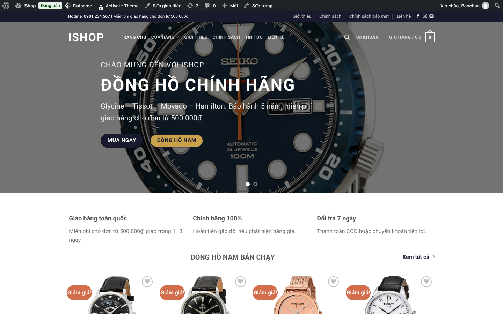
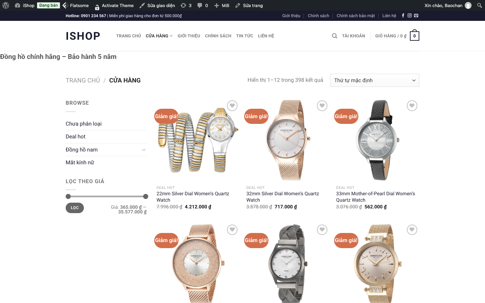
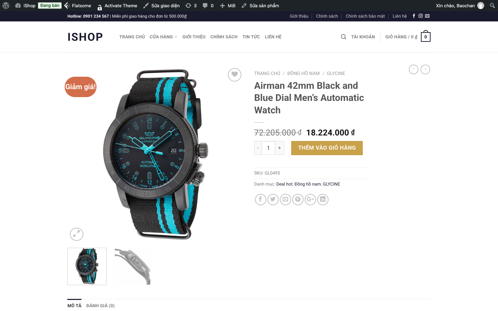
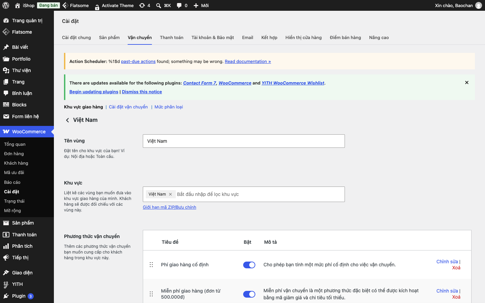
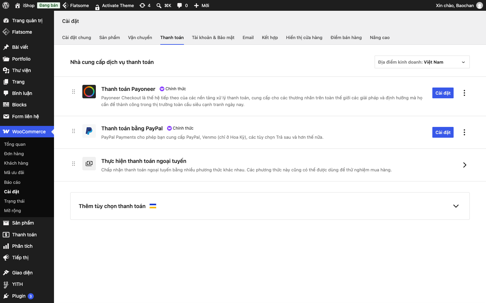
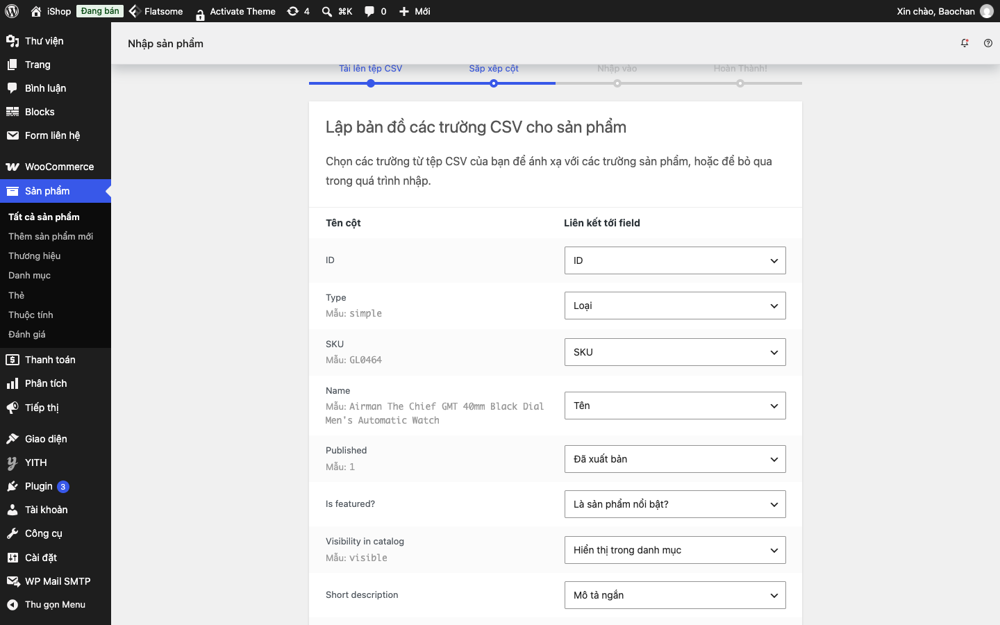
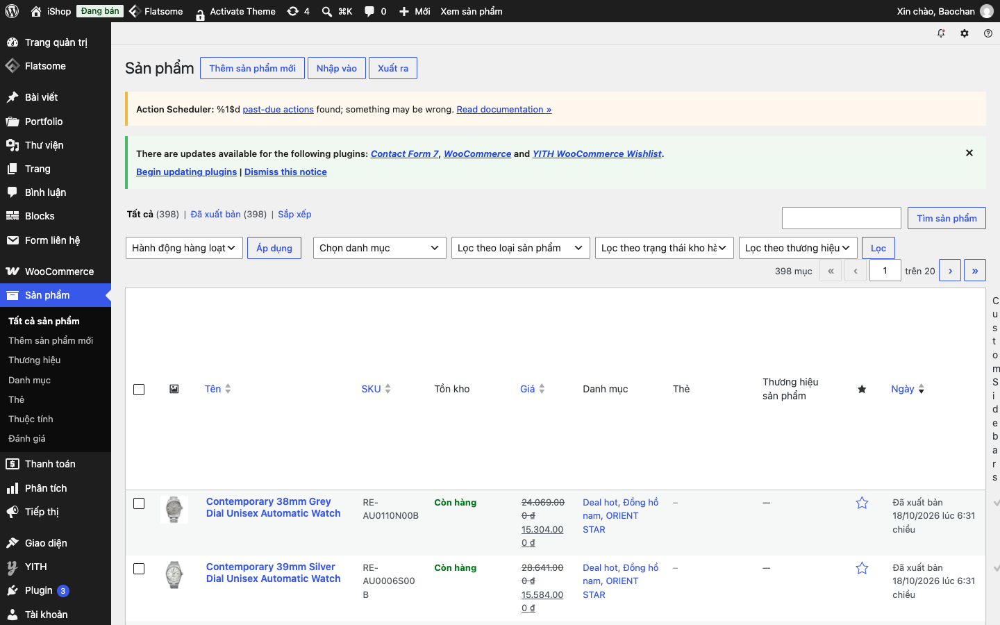

# iShop – Shop đồng hồ WooCommerce trên Docker (LEMP)

Lab02 môn Thiết kế Hệ thống Thương mại điện tử (EC312, UIT): dựng một cửa hàng bán đồng hồ hoàn chỉnh bằng WordPress + WooCommerce, chạy trên stack **Linux · Nginx · MySQL · PHP** bằng Docker Compose.



## Đã làm được

- **Hạ tầng**: Nginx + PHP-FPM 8.3 + MySQL 8.4, mỗi dịch vụ một container.
- **Cửa hàng**: theme Flatsome + child theme, menu, danh mục, trang Giới thiệu / Chính sách / Liên hệ.
- **~400 sản phẩm** nhập bằng CSV (dữ liệu tạo bởi [watch-crawler](https://github.com/GiaBao-source206/watch-crawler)).
- **Vận chuyển**: vùng giao hàng Việt Nam, phí cố định 30.000₫, miễn phí cho đơn từ 500.000₫.
- **Thanh toán**: COD và chuyển khoản ngân hàng.
- **Email**: gửi email đơn hàng qua SMTP (WP Mail SMTP).
- **Việt hoá**: `functions.php` của child theme dịch các chuỗi còn tiếng Anh của Flatsome và YITH Wishlist (2 plugin này không có gói tiếng Việt).
- **Phân tích nghiệp vụ**: quy trình mua hàng và xử lý đơn (BPMN), customer journey, sơ đồ kênh tiếp cận khách hàng trong [`docs/business`](docs/business).

## Cấu trúc

```
docker-compose.yml          3 dịch vụ: nginx, php, mysql
docker/
  php/Dockerfile            php:8.3-fpm + mysqli, pdo_mysql
  nginx/default.conf        cấu hình Nginx cho WordPress
src/                        mã nguồn WordPress (chỉ child theme được commit)
  wp-content/themes/flatsome-child/
docs/screenshots/           ảnh chụp kết quả
docs/business/              BPMN, customer journey, sơ đồ kênh
```

## Chạy lại trên máy

```bash
# 1. Tải WordPress vào thư mục src/ (giữ nguyên child theme đã có)
curl -L https://wordpress.org/latest.tar.gz | tar -xz --strip-components=1 -C src

# 2. Khởi động
docker compose up -d --build

# 3. Mở http://localhost:8080 và cài WordPress với:
#    Database: app · User: app · Password: app · Host: mysql
```

Sau đó cài các plugin: **WooCommerce**, **WP Mail SMTP**, **YITH WooCommerce Wishlist**, **Contact Form 7**, **WooSidebars**, **Nextend Social Login**. Theme **Flatsome** là theme trả phí nên không có trong repo, cần mua và cài riêng rồi kích hoạt `flatsome-child`.

> Mật khẩu trong `docker-compose.yml` chỉ dùng cho máy local. Đổi trước khi đưa lên server thật.

## Ảnh chụp

| Cửa hàng | Trang sản phẩm |
|---|---|
|  |  |

| Vùng giao hàng Việt Nam | Phương thức thanh toán |
|---|---|
|  |  |

| Nhập sản phẩm bằng CSV | Danh sách sản phẩm |
|---|---|
|  |  |

Xem thêm trong [`docs/screenshots`](docs/screenshots).
